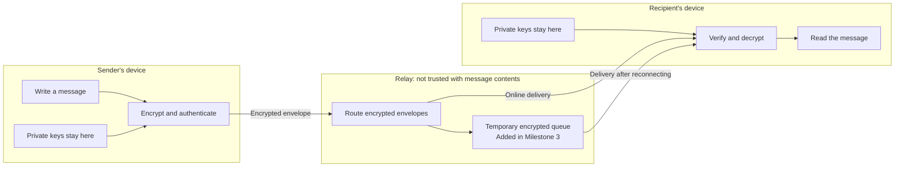
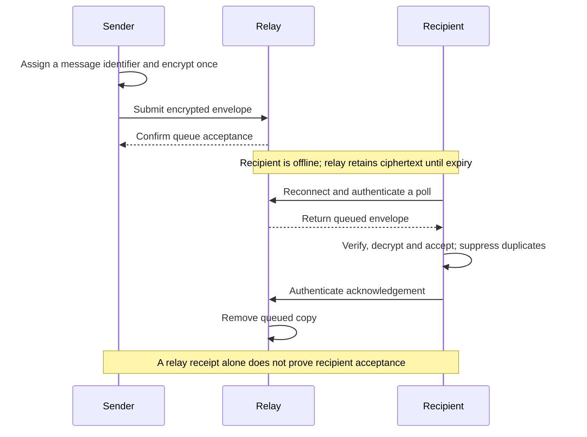

# Defining Vayu

I am building Vayu as an encrypted, delay-tolerant messenger, with journalists, whistleblowers and "spies" in mind. I want people to communicate without giving the service their name, phone number or email address, or trusting it with their messages.

## Architecture and identity

The **client** will manage keys, encrypt messages and read them. The **relay** will route encrypted envelopes. I will start with two command-line clients and a local relay, using separate Rust modules.

Envelopes will carry ciphertext, routing details, delivery identifiers and expiry. Relevant fields will be authenticated against tampering. Private keys and readable messages will stay on clients.

Clients will create keys locally and register an opaque identifier with proof of key ownership. Contact names will stay local. Key replacement, collection and acknowledgement will require authentication and replay protection.

I will verify contact key fingerprints outside the relay through a trusted channel. Later key lookup must still warn about changed keys.

This gives pseudonymity, but does not hide IP addresses, connection times or relationships between identifiers. I will minimise retained metadata and avoid logging secrets or contact details. Network anonymity, such as Tor, remains optional.

## Encryption

Messages will be encrypted and decrypted by clients. Remote connections will use TLS with certificate verification. I will use established libraries, secure randomness and authenticated encryption, rejecting invalid messages without falling back to readable text.

My initial choice is **MLS through [OpenMLS](https://docs.rs/openmls/0.9.0/openmls/)** for two-client conversations.

Identities will use signing keys and credentials containing opaque identifiers. Contacts will pin verified keys. Public [key packages](https://book.openmls.tech/user_manual/create_key_package.html) allow offline conversation setup; their private parts (ha funny) stay on the recipient's device.

MLS key-state changes need consistent ordering. Delayed messages need bounded retention of old keys, trading some [forward secrecy](https://book.openmls.tech/forward_secrecy.html) for delayed delivery. I will define limits alongside expiry. Relay access control and receipts remain Vayu's responsibility; I will not claim cryptographic deniability.

## Offline delivery

In Milestone 3, the relay will queue encrypted messages until expiry or authenticated recipient acknowledgement, then remove them. Duplicate records will have bounded lifetimes. The queue will be temporary.

## Client storage

Each client will use a selected profile directory. Keys, contacts and MLS state will go in **SQLite encrypted with [SQLCipher](https://www.zetetic.net/sqlcipher/design/)**, unlocked through a hidden passphrase prompt. I will reject unencrypted SQLite and keep passphrases out of configuration, arguments and logs.

I plan to use OpenMLS's SQLite provider with SQLCipher, using Cargo-locked versions. Non-secret settings will go in `config.toml`. The relay will initially hold state in memory and lose it on restart.

Old keys must be removed when no longer needed. Encryption does not prevent restoring an old database, so restored profiles will need fresh conversations. Secure deletion remains a limitation. Portable storage and memory-only operation remain optional and will need checks for logs, temporary files, swap and crash dumps.

## Milestones and checks

- **Milestone 1:** local encrypted exchange; check tampering, wrong recipient keys, profile reload and wrong passphrases.
- **Milestone 2:** separate network relay, TLS and access control.
- **Milestone 3:** offline delivery, expiry, retries, duplicates, delayed key-state changes and restart recovery.
- **Milestone 4:** usable contacts, configuration and storage, including persistent history.