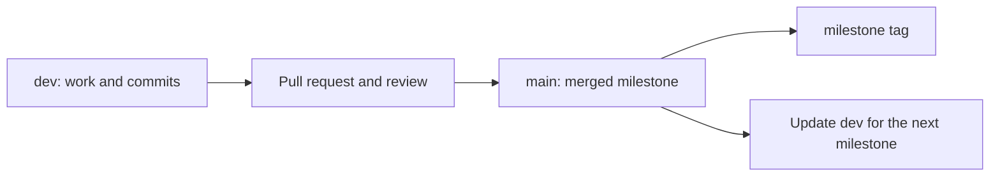

# Using Git as project evidence

I have used git extensively in other projects, as it provides a simple, elegant solution to the problems of version control, archiving and evidencing. 
I will use git to track progress, and to provide evidence of my work. Commit messages on changes will be used to explain small changes, and tags will be used to mark completed milestones. This should prove to be a robust, simple, method. 
Through git's inbuild time logging, and "blame", I will be able to show when, how and why changes were made. The git repository will be hosted on GitHub, whih provides inbuilt markdown, mermaid.js, and image support. This provides the clear choice in using markdown as documentation, as it is simple, and can be easily editied, both through git, and VSCode. 

The repository will be split between to branches, `dev` and `main`. The `dev` branch will act as the working branch, where all changes will be made, committed and pushed. The `main` branch will be the stable "production" branch, where all completed milestones (and possibly phases), will be merged to. 

I will make use of git tags to mark completed milestones, which provides an easy method to show the project at different reference points, where all files will be in the state they were at the time of the tag. This makes mismatches in file versions, and how they link to markdown documentation, much easier to manage. 
To avoid any ambiguity in documentation linking, I will use explicit markdown links, which will link to a specific commit, or tag, rather than relative linking to a file, which may change location/state. 

## How a milestone will reach `main`

I will commit the work for a milestone on `dev`. Once that milestone is finished, i will open a pull request into `main`. I will use a merge commit so the smaller development commits remain visible. The milestone tag will point to the merged commit on `main`, not to an earlier verion on `dev`. Phases will guide the development process, but will not branch or tag for each one, as this has created problems in my EPQ. 



For example, after i have made a small change, I can stage the relevent files, and check what i am about to commit: 

```zsh
git switch dev # Switches to the development branch
git status --short # Shows the files that have been changed
git add <file> # Stages the given file for commit
git diff --cached --check # Shows the changes that are staged for commit, and checks for any whitespace errors
git commit -m "<commit message>"
git push # Pushes the changes to the remote repository
```

At the end of a milestone, after the code, evidence and tests are ready, I can open the pull request: 

```zsh
git push origin dev
gh pr create --base main --head dev --title "<Milestone<N>: <Milestone title>>" --body "<Milestone body>"
```

After reveiwing and merging the pull request, I can tag the merged version and bring `dev` up to date:

```zsh
git switch main
git pull --ff-only origin main
git tag -a milestone-<N> -m "Milestone <N>: <Milestone title>"
git push origin milestone-<N>
git switch dev
git merge --ff-only main
git push origin dev
```